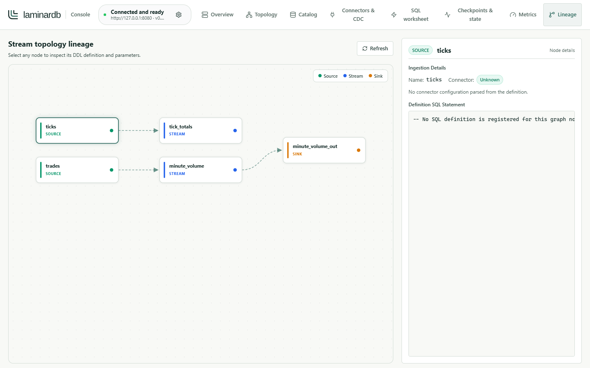

<p>
  <picture>
    <source media="(prefers-color-scheme: dark)" srcset="src/assets/brand/laminardb-logo-on-dark.svg">
    
  </picture>
</p>

# LaminarDB Console

A browser console for a [LaminarDB](https://github.com/laminardb/laminardb) server you run. It
calls the server's HTTP and WebSocket API from your browser. It does not embed the engine, store
pipeline data, or proxy requests; everything it shows comes from the server you connect it to.



<sub>Lineage tab connected to a local LaminarDB 0.32.0 server running demonstration data. See
[how the screenshot was made](docs/images/README.md).</sub>

## What it does

- Health, readiness, pipeline lifecycle, cluster membership, leader, and exact vnode-assignment views.
- Cluster topology migrations: versioned catalog status, legacy adoption, effect-free validation,
  atomic submission with safe identity reuse, durable phase tracking, and ownership/rescale guidance.
- HTTP SQL execution plus browser WebSocket subscriptions, including checkpoint-committed cluster
  aggregate streams.
- Source, sink, stream, materialized-view, process-function, connector, and lineage inspection,
  with schema-capability-aware DDL generation for Kafka, CDC (PostgreSQL, MongoDB, Delta change
  data feed), lakehouse and other connectors.
- Connector and CDC health: snapshot progress, replication lag and orphaned slots, Kafka reader lag
  per partition, Iceberg/Delta commit state, schema resolution and source-queue admission.
- Current checkpoint status, manual checkpoints, managed-state accounting, and checkpoint latency.
- A raw Prometheus browser and charts built only from metrics the pinned engine registers.
- Lossless handling of Rust `u64` values and Arrow integer/decimal JSON.
- Session-scoped bearer credentials, explicit confirmations before changes, secret-aware SQL and
  config display, keyboard-safe dialogs, reduced-motion support, and accessible status, table and
  chart summaries.

## Which LaminarDB it works with

This branch is reviewed against LaminarDB `0.32.0` at engine `main` commit
`bd8f85e82ac3c23a5c3f4acc3500e20e79e15a56` (the previous review, 0.30 cluster subscriptions,
merged as `e3ad6123`). The released `laminardb/laminardb-server:0.32.0` image and the v0.32.0
binaries are built from tag `v0.32.0` (`907d3dfa`); the pinned commit is that tag plus one change
to a CI workflow, so the two expose the same HTTP and WebSocket surface. The Console warns when a
server reports a different version.

The implementation-derived compatibility record is
[docs/laminardb-v0.32-console-contract.md](docs/laminardb-v0.32-console-contract.md). Read it
before using this Console with a different `0.32.0` build or a later engine commit.

## Run it

You need a LaminarDB server whose HTTP listener your browser can reach. The server default is
`127.0.0.1:8080`; the engine README's
[quick start](https://github.com/laminardb/laminardb#quick-start) starts one with Docker.

- **Hosted build.** <https://laminardb.github.io/laminardb-console-ui/> is built from `main`. The
  page runs in your browser and connects directly to the server address you enter; nothing is
  hosted for you, and the server must be reachable from your machine. Because the page comes from a
  public HTTPS origin, browsers that restrict access to local addresses (Chrome asks for local
  network access) must be allowed to reach a server on `localhost` or your private network;
  if the request is denied, the Console reports "Failed to fetch". Running the Console locally
  avoids this.
- **Development server.** With a current Node.js release supported by Vite 8:

  ```bash
  npm ci
  npm run dev
  ```

  Open `http://localhost:5173`, then use Settings to enter the server's base URL and console token.
- **Your own static host.** `npm run build` writes static assets to `dist/`. The
  [Dockerfile](Dockerfile) builds them and serves them with nginx on port 80:

  ```bash
  docker build -t laminardb-console .
  docker run --rm -p 8081:80 laminardb-console
  ```

## Connect to a server

```toml
[server]
bind = "127.0.0.1:8080"
console_token = "replace-with-a-secret"
console_cors_allowed_origins = ["http://localhost:5173"]
```

- **Token.** Protected routes need `Authorization: Bearer <console_token>` when the server sets a
  token. Leaving `console_token` unset makes the control plane unauthenticated, which the engine
  permits only for a loopback `bind`.
- **CORS.** `console_cors_allowed_origins` is an exact allow-list. Include the origin you load the
  Console from, such as `http://localhost:5173` or `https://laminardb.github.io`. Leaving it unset
  keeps the engine's permissive legacy CORS policy.
- **Storage.** The base URL is kept in local storage; the token is held only in session storage.
  Browser WebSocket authentication places the token in the upgrade query string, because the
  WebSocket API cannot set an `Authorization` header.

## Verify and build

```bash
npm test
npm run lint
npm run build
npm audit
```

## Important boundaries

- `/health`, `/ready`, and `/metrics` are public server routes. Other console routes are
  bearer-protected when `console_token` is configured.
- `Stopped` is a reachable server state even though `/health` returns HTTP 503 and `/ready` is not
  ready.
- Browser subscriptions use only `/ws/{name}`. They accept protocol control frames from the client,
  not application messages.
- Local `SUBSCRIBE` accepts resolved streams and materialized views and keeps retained history in
  memory. Cluster `SUBSCRIBE` admits only named, non-windowed managed keyed aggregate streams with
  planner-certified vnode distribution; MVs and other stream shapes fail closed.
- Cluster delivery becomes visible only after whole-cluster checkpoint commits. Data is ordered only
  within each output partition; gateway interleaving is not a global, arrival, event-time, or SQL
  order.
- Cluster `AS OF EPOCH` resumes from every partition's exclusive committed frontier using
  byte-bounded durable checkpoint segments. It is checkpoint-granular replay, not a named consumer
  acknowledgement, so a partly consumed interval can be delivered again.
- Cluster WebSocket data carries all four of `stream_generation`, `partition`,
  `partition_sequence`, and `committed_epoch` (the fields are absent together on local frames); the
  Console uses this durable identity for replay deduplication. Resume tokens are not exposed by the
  current WebSocket query contract.
- Cluster start/stop peer fan-out is fire-and-forget. Success proves the local operation, not
  cluster-wide convergence.
- `/api/v1/cluster/checkpoints` reports one current row, not checkpoint history. Manual
  `RESTORE FROM CHECKPOINT` is not implemented.
- In a running cluster, SOURCE/STREAM/SINK DDL is an asynchronous topology migration (HTTP 202
  receipt), not an applied change. A migration is irreversible once Committed; the Console tracks
  it until Active or Aborted. Materialized views, tables and lookups are not migratable, and there
  is no rescale API: scale out by starting a node with a new `node_id`, scale in with SIGTERM, and
  do neither while a migration is still settling (`live_migration`).
- Legacy adoption needs the deployment UUID from the checkpoint store; no HTTP route exposes it
  before adoption. Topology activation evidence is per node.
- Hyphenated connector names must be quoted in DDL (`FROM "postgres-cdc"`); the generated SQL does
  this.
- The schema-versioned local cluster diagnostic routes are intentionally outside console CORS and
  are not rendered by this app.
- Connector discovery reports compiled streaming roles, option metadata and schema capabilities,
  not delivery or cluster-admission guarantees. Connector metric families other than Kafka reader
  lag carry no connector-name label, so a second same-type connector on one node is not separately
  visible.
- The Console has a light theme only.

## Updating the engine pin

Do not update only the version label. Fetch `main`, record the new SHA, diff it against the pin
above, and update together:

- `src/contract.ts`;
- `docs/laminardb-v0.32-console-contract.md` (or the next-version contract);
- the SHA-pinned protocol fixture suites.

## Brand assets

The logo, mark and favicons in `src/assets/brand/` and `public/` are generated from the canonical
sources in the engine repository's [`brand/`](https://github.com/laminardb/laminardb/tree/main/brand)
directory by `brand/tools/build.py --console <path to this checkout>`. Edit the sources there, not
these copies.
